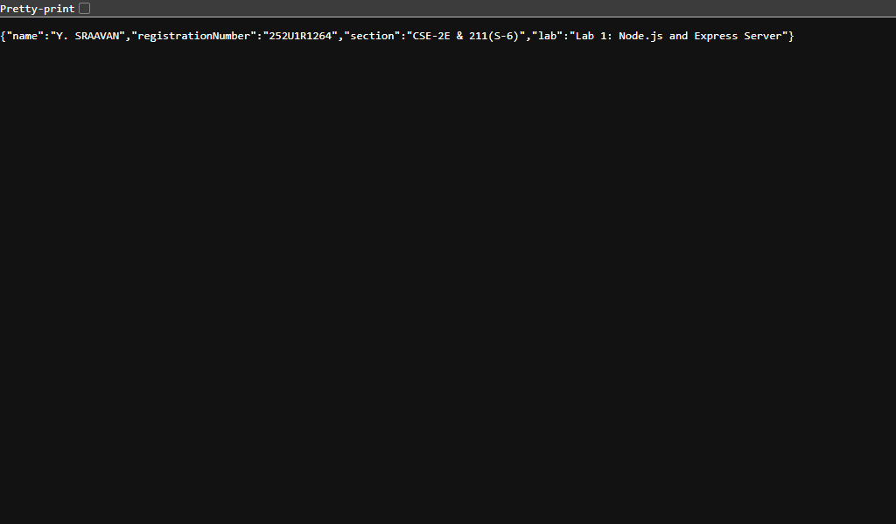
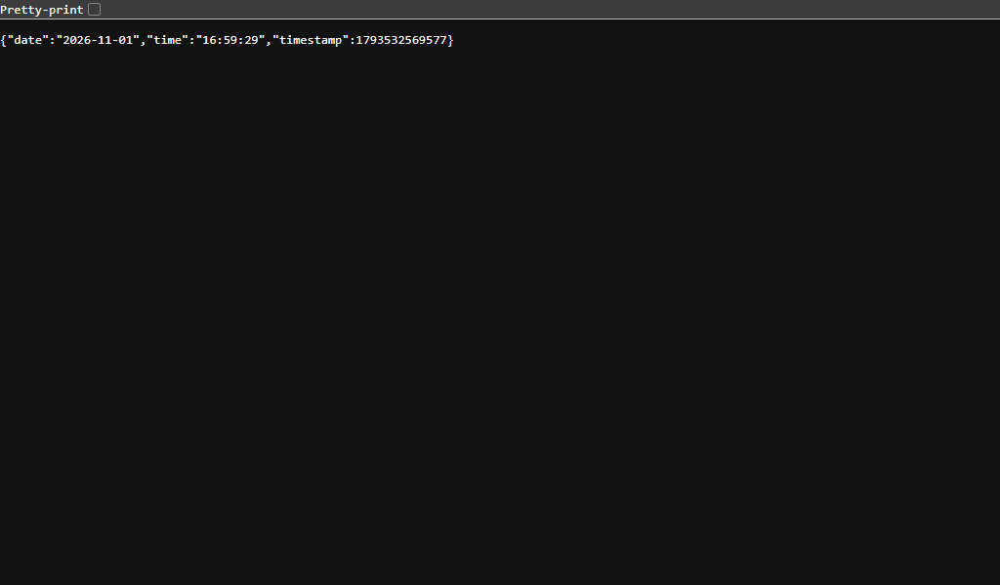
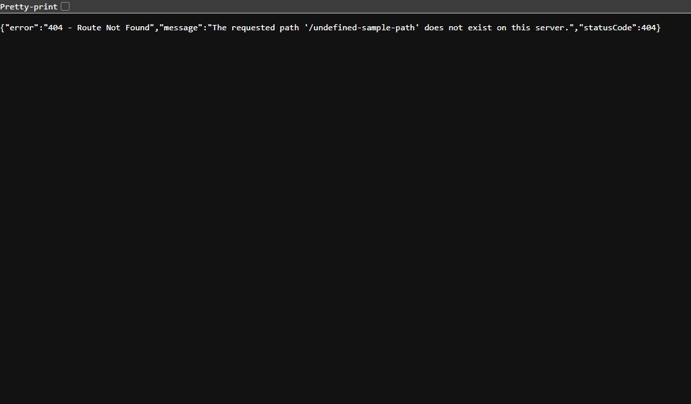

# Lab 1: Node.js and Express Server

> **🔗 Live Deployment URL:** [https://r-manikanta.onrender.com](https://r-manikanta.onrender.com)

---

## 📋 Student Information

| Field | Details |
|-------|---------|
| **Name** | Yarraballi Sraavan |
| **Registration Number** | 252U1R1264 |
| **Section** | CSE-2E 211 |
| **Course** | Backend Development Fundamentals |
| **Faculty** | Mr Yugandhar Gurjalwar |
| **College** | Aurora Deemed-to-be-University |

---

## 🎯 Objective

Set up a Node.js project and build a small web server, first with the built-in `http` module and then with **Express.js**. The server should handle multiple routes and return appropriate HTTP status codes.

---

## 🛠️ Technologies Used

| Technology | Purpose |
|------------|---------|
| **Node.js** | JavaScript runtime environment for server-side programming |
| **Express.js** | Web framework for Node.js to simplify HTTP server creation |
| **npm** | Node Package Manager for managing project dependencies |
| **Git** | Version control system |
| **GitHub** | Remote repository hosting |
| **Render** | Cloud deployment platform |

---

## 📦 Understanding package.json

The `package.json` file is the heart of any Node.js project. Here is an explanation of each field:

| Field | Description |
|-------|-------------|
| `name` | The name of the project (must be lowercase, no spaces) |
| `version` | The current version of the project (follows semantic versioning) |
| `description` | A short description of what the project does |
| `main` | The entry point file of the application (default: `index.js`) |
| `scripts` | Custom commands that can be run using `npm run <script-name>` |
| `keywords` | An array of keywords to help others find the package |
| `author` | The name of the project creator |
| `license` | The license type for the project |
| `dependencies` | Packages required for the project to run in production |

---

## ⚙️ Installation & Setup

### Prerequisites

- **Node.js** (v14 or higher) – [Download here](https://nodejs.org/)
- **npm** (comes with Node.js)
- **Git** – [Download here](https://git-scm.com/)

### Steps

1. **Clone the repository:**
   ```bash
   git clone https://github.com/sraavan09-cmd/Y.Sraavan.git
   cd lab-01
   ```

2. **Install dependencies:**
   ```bash
   npm install
   ```

3. **Run the Express server:**
   ```bash
   npm start
   ```

4. **Run the plain HTTP server (optional):**
   ```bash
   npm run http
   ```

5. **Open your browser and visit:**
   - Home: [http://localhost:3000/](http://localhost:3000/)
   - About: [http://localhost:3000/about](http://localhost:3000/about)
   - Time: [http://localhost:3000/time](http://localhost:3000/time)

---

## 🖥️ Server Explanations

### 1. Plain Node.js HTTP Server (`http-server.js`)

This server uses the **built-in `http` module** that comes with Node.js. No external packages are needed.

- Uses `http.createServer()` to create the server
- Takes a callback with `request` and `response` objects
- Returns `"Hello"` as plain text
- Listens on port 3000

**How to run:**
```bash
node http-server.js
```

### 2. Express Server (`server.js`)

This server uses the **Express.js framework**, which simplifies route handling and middleware.

- Uses `express()` to create the app
- Defines routes using `app.get()`
- Includes a 404 middleware for unknown routes
- Uses `process.env.PORT` for deployment compatibility

**How to run:**
```bash
npm start
```

---

## 📡 API Endpoints

| Method | Path | Live URL | Description | Status Code |
|:---|:---|:---|:---|:---|
| `GET` | `/` | [Open Live Link](https://r-manikanta.onrender.com/) | Returns a welcome message with student name and lab info | `200 OK` |
| `GET` | `/about` | [Open Live Link](https://r-manikanta.onrender.com/about) | Returns student details (name, reg. no., section) in JSON | `200 OK` |
| `GET` | `/time` | [Open Live Link](https://r-manikanta.onrender.com/time) | Returns the current server date and time | `200 OK` |
| `GET` | `/unknown` | [Open Live Link (404 Test)](https://r-manikanta.onrender.com/unknown) | Any undefined route returns a 404 error message | `404 Not Found` |

### Example Responses

**GET /**
```json
{
  "message": "Welcome to the Backend Development Fundamentals Lab 1!",
  "student": "Yarraballi Sraavan",
  "lab": "Lab 1 - Node.js and Express Server"
}
```

**GET /about**
```json
{
  "name": "Yarraballi Sraavan",
  "registrationNumber": "252U1R1264",
  "section": "CSE-2E 211",
  "course": "Backend Development Fundamentals",
  "college": "Aurora Deemed-to-be-University"
}
```

**GET /time**
```json
{
  "currentDateTime": "Sat Nov 01 2026 09:50:00 GMT+0530 (India Standard Time)",
  "isoFormat": "2026-11-01T04:20:00.000Z",
  "message": "This is the current server date and time."
}
```

**GET /unknown (404)**
```json
{
  "error": "Route not found",
  "message": "The route '/unknown' does not exist on this server.",
  "statusCode": 404
}
```

---

## 📸 Screenshots

### 1. Home Endpoint – GET /


### 2. About Endpoint – GET /about


### 3. Time Endpoint – GET /time


### 4. 404 Error – GET /unknown


> ✅ All screenshots captured successfully from Chrome browser.

---

## 🚀 Deployment on Render

### Steps to Deploy

1. **Sign up** on [Render](https://render.com/) using your GitHub account.

2. **Create a New Web Service:**
   - Click **"New +"** → **"Web Service"**
   - Connect your GitHub repository: `Y.Sraavan`

3. **Configure the Service:**
   | Setting | Value |
   |---------|-------|
   | **Name** | `sraavan-lab01` |
   | **Root Directory** | `lab-01` |
   | **Runtime** | Node |
   | **Build Command** | `npm install` |
   | **Start Command** | `npm start` |

4. **Deploy** and wait for the build to complete.

5. **Verify** by visiting the provided Render URL and testing all endpoints:
   - **GET / (Welcome):** [https://r-manikanta.onrender.com/](https://r-manikanta.onrender.com/)
   - **GET /about (Student Info):** [https://r-manikanta.onrender.com/about](https://r-manikanta.onrender.com/about)
   - **GET /time (Current Time):** [https://r-manikanta.onrender.com/time](https://r-manikanta.onrender.com/time)
   - **GET /unknown (404 Test):** [https://r-manikanta.onrender.com/unknown](https://r-manikanta.onrender.com/unknown)

---

## ❗ Problems Faced and Solutions

| Problem | Solution |
|---------|----------|
| `npm: command not found` | Installed Node.js from the official website, which includes npm |
| `Cannot find module 'express'` | Ran `npm install` in the lab-01 directory to install dependencies |
| Port already in use | Changed the port or killed the process using the port with `npx kill-port 3000` |
| 404 not working for unknown routes | Added the 404 middleware **after** all route definitions in server.js |

---

## ✅ Conclusion

In this lab, I learned:

1. **How to create a basic HTTP server** using Node.js built-in `http` module.
2. **How to use Express.js** to create a more structured and readable web server.
3. **How to define routes** (`GET /`, `GET /about`, `GET /time`) and handle requests.
4. **How to implement error handling** with a 404 middleware for unknown routes.
5. **The importance of `package.json`** in managing project metadata and dependencies.
6. **How to use `process.env.PORT`** for deployment compatibility.
7. **How to prepare a project for GitHub** with proper `.gitignore` and documentation.

This lab provided hands-on experience with backend development fundamentals and laid the foundation for building more complex applications in upcoming labs.

---

## 👤 Author

**Yarraballi Sraavan** – 252U1R1264 – CSE-2E 211

