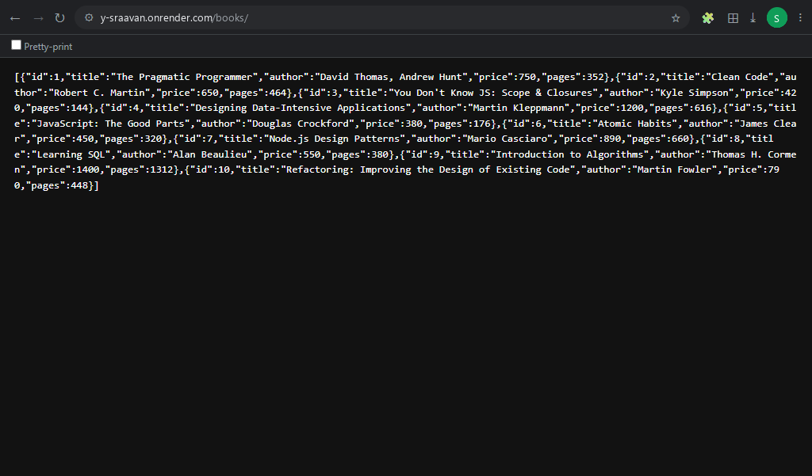
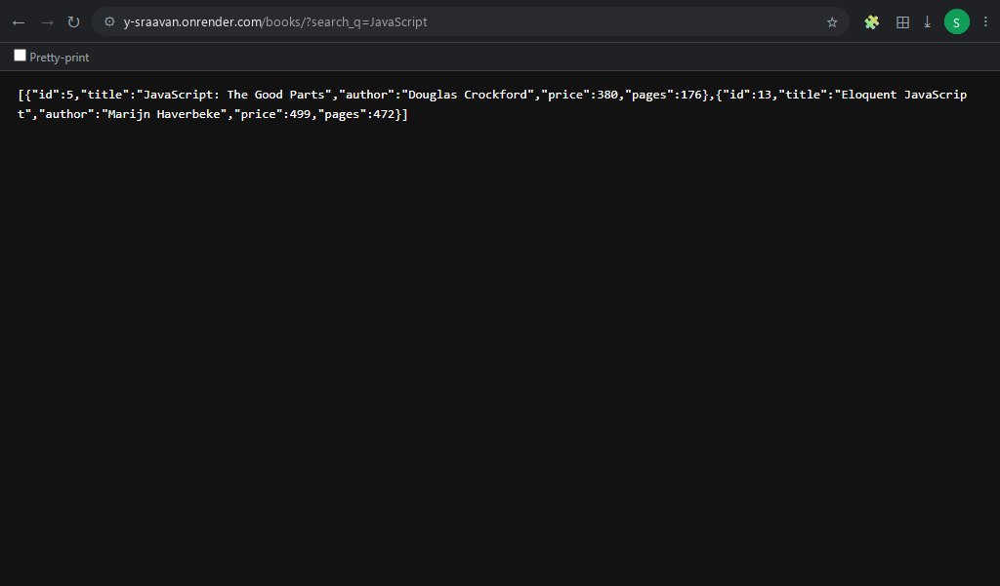
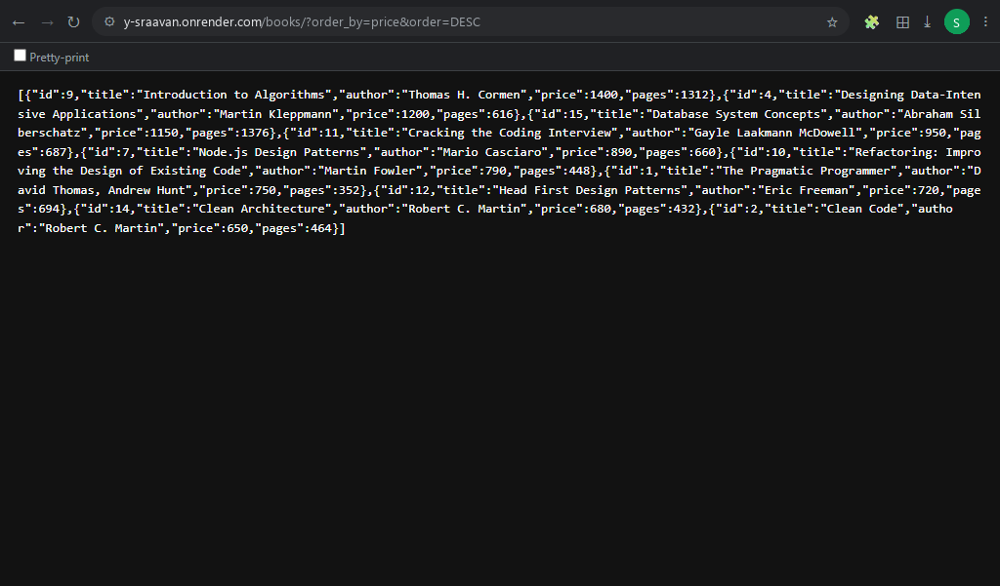
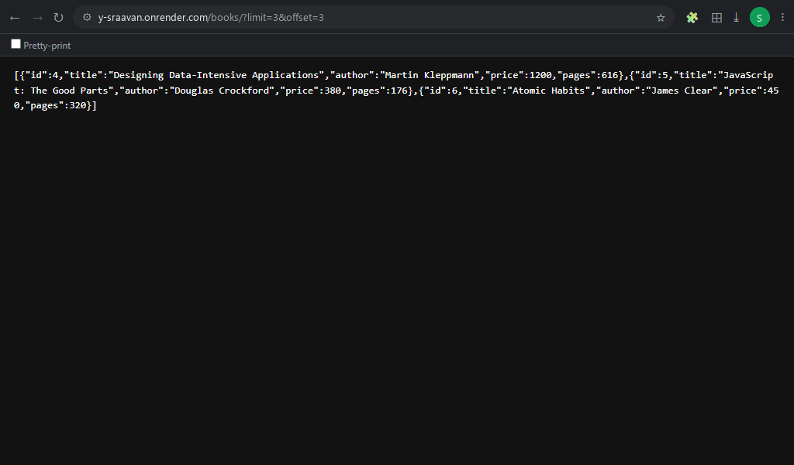
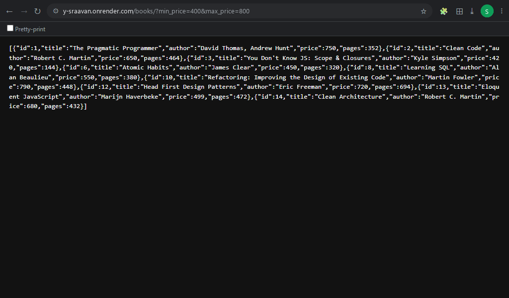
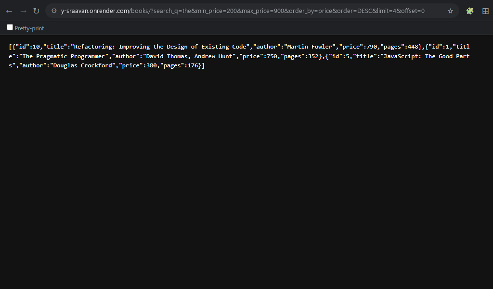
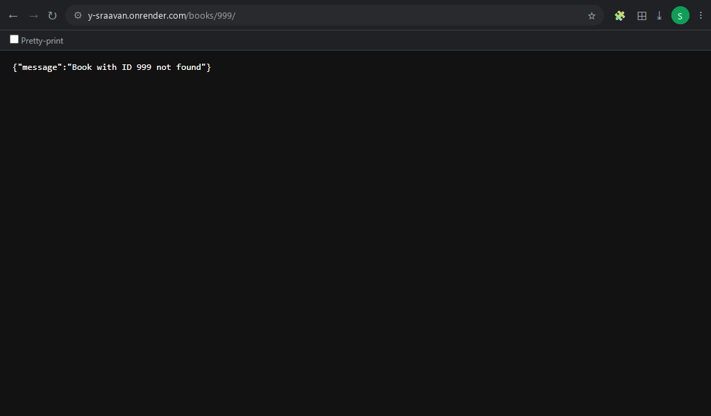

# Lab 3: REST API, Query Parameters, Validation, and Debugging

> **🔗 Live Deployment URL:** [https://r-manikanta-unzk.onrender.com](https://r-manikanta-unzk.onrender.com)

---

## 📋 Student Information

| Field | Details |
|-------|---------|
| **Name** | Yarraballi Sraavan |
| **Registration Number** | 252U1R1264 |
| **Section** | CSE-2E 211 |
| **Course** | Backend Development Fundamentals |
| **Faculty** | Mr Yugandhar Gurjalwar |
| **College** | Aurora Deemed-to-be-University |

---

## 🎯 Objective

Build a production-ready Node.js and Express RESTful API with SQLite database integration. Implement advanced query parameter features on `GET /books/` (search, ordering, direction, pagination, and price range filters), enforce strict request payload validation with consistent JSON error responses, apply whitelisting and parameterized queries (`?`) to prevent SQL injection, and analyze deliberate server bugs in a dedicated debugging module.

---

## 🛠️ Technologies Used

| Technology | Purpose |
|------------|---------|
| **Node.js** | JavaScript runtime environment for backend execution |
| **Express.js** | Web framework for routing and building RESTful APIs |
| **SQLite** | Lightweight, self-contained, file-based relational database |
| **sqlite / sqlite3** | Asynchronous promise-based Node.js SQLite client and driver |
| **nodemon** | Development tool for automated server restarts on file modifications |
| **Postman** | Comprehensive API design, request verification, and testing suite |
| **Git & GitHub** | Distributed version control and remote code repository |
| **Render** | Cloud hosting platform for live application deployment |

---

## 🗄️ Database Structure

**Database File:** `database.db`

**Table:** `book`

| Column | Type | Description |
|--------|------|-------------|
| `id` | INTEGER PRIMARY KEY AUTOINCREMENT | Unique identifier for each book |
| `title` | TEXT NOT NULL | Title of the book |
| `author` | TEXT NOT NULL | Full name of the author |
| `price` | INTEGER NOT NULL | Price in Indian Rupees (INR) |
| `pages` | INTEGER NOT NULL | Total page count |

### Sample Data (15 Books)

| ID | Title | Author | Price (₹) | Pages |
|----|-------|--------|-----------|-------|
| 1 | The Pragmatic Programmer | David Thomas, Andrew Hunt | 750 | 352 |
| 2 | Clean Code | Robert C. Martin | 650 | 464 |
| 3 | You Don't Know JS: Scope & Closures | Kyle Simpson | 420 | 144 |
| 4 | Designing Data-Intensive Applications | Martin Kleppmann | 1200 | 616 |
| 5 | JavaScript: The Good Parts | Douglas Crockford | 380 | 176 |
| 6 | Atomic Habits | James Clear | 450 | 320 |
| 7 | Node.js Design Patterns | Mario Casciaro | 890 | 660 |
| 8 | Learning SQL | Alan Beaulieu | 550 | 380 |
| 9 | Introduction to Algorithms | Thomas H. Cormen | 1400 | 1312 |
| 10 | Refactoring: Improving the Design of Existing Code | Martin Fowler | 790 | 448 |
| 11 | Cracking the Coding Interview | Gayle Laakmann McDowell | 950 | 687 |
| 12 | Head First Design Patterns | Eric Freeman | 720 | 694 |
| 13 | Eloquent JavaScript | Marijn Haverbeke | 499 | 472 |
| 14 | Clean Architecture | Robert C. Martin | 680 | 432 |
| 15 | Database System Concepts | Abraham Silberschatz | 1150 | 1376 |

---

## 🔌 Database Initialization

The asynchronous initialization routine `initializeDBAndServer()` executes at startup:

1. Connects to `database.db` using the `open()` method from `sqlite` and the `sqlite3.Database` driver.
2. Creates the `book` table using `CREATE TABLE IF NOT EXISTS` if not already present.
3. Automatically seeds 15 realistic book records if the total record count is below 15, ensuring testing data for search, pagination, and sorting.
4. Binds the Express server to `process.env.PORT || 3000`.
5. Attaches an event listener to gracefully capture and report `EADDRINUSE` port conflict errors.

---

## ⚙️ Installation & Setup

### Prerequisites

- **Node.js** (v18.x or v20.x LTS)
- **npm** (comes bundled with Node.js)

### Steps

1. **Navigate to the lab-03 directory:**
   ```bash
   cd lab-03
   ```

2. **Install dependencies:**
   ```bash
   npm install
   ```

3. **Configure Environment:**
   Create a `.env` file from `.env.example` if a custom port is required:
   ```env
   PORT=3000
   ```

4. **Start the server (Production):**
   ```bash
   npm start
   ```

5. **Start with auto-reload (Development):**
   ```bash
   npm run dev
   ```

6. **Local Server URL:** [http://localhost:3000](http://localhost:3000)

---

## 📡 API Endpoints

| Method | Path | Live URL | Description | Status Code |
|:---|:---|:---|:---|:---|
| `GET` | `/` | [Open Live Link](https://r-manikanta-unzk.onrender.com/) | API Directory, student info & system status | `200 OK` |
| `GET` | `/books/` | [Open Live Link](https://r-manikanta-unzk.onrender.com/books/) | Retrieve books with optional query parameters | `200 OK` / `400 Bad Request` |
| `GET` | `/books/:bookId/` | [Open Live Link (ID 1)](https://r-manikanta-unzk.onrender.com/books/1/) | Retrieve a single book by ID | `200 OK` / `400 Bad Request` / `404 Not Found` |
| `POST` | `/books/` | [API Endpoint](https://r-manikanta-unzk.onrender.com/books/) | Create and insert a new book record | `201 Created` / `400 Bad Request` |
| `PUT` | `/books/:bookId/` | [API Endpoint (ID 1)](https://r-manikanta-unzk.onrender.com/books/1/) | Update details of an existing book by ID | `200 OK` / `400 Bad Request` / `404 Not Found` |
| `DELETE` | `/books/:bookId/` | [API Endpoint (ID 15)](https://r-manikanta-unzk.onrender.com/books/15/) | Delete a book record by ID | `200 OK` / `400 Bad Request` / `404 Not Found` |
| `GET` | `/books/999/` | [Open Live Link (404 Test)](https://r-manikanta-unzk.onrender.com/books/999/) | Test 404 response for non-existent record | `404 Not Found` |

---

## 🔍 Query Parameters on GET /books/

All query parameters are optional and have built-in default values. They can be utilized individually or combined:

| Parameter | Type | Default | Allowed Values / Constraints | Description |
|-----------|------|---------|------------------------------|-------------|
| `search_q` | String | `""` | Any search text | Case-insensitive title search via `LIKE '%term%'` |
| `order_by` | String | `"id"` | `id`, `title`, `author`, `price`, `pages` | Whitelisted column name to order results by |
| `order` | String | `"ASC"` | `ASC`, `DESC` (case-insensitive) | Sort direction (ascending or descending) |
| `limit` | Integer | `10` | Non-negative integer (`>= 0`) | Maximum number of book records to return |
| `offset` | Integer | `0` | Non-negative integer (`>= 0`) | Number of book records to skip (for pagination) |
| `min_price` | Number | None | Non-negative number (`>= 0`) | Lower bound price filter (`price >= min_price`) |
| `max_price` | Number | None | Non-negative number (`>= 0`) | Upper bound price filter (`price <= max_price`) |

---

## 📝 Sample Request Bodies

### POST /books/ (Add a new book)
```json
{
  "title": "System Design Interview",
  "author": "Alex Xu",
  "price": 850,
  "pages": 300
}
```

### PUT /books/:bookId/ (Update a book)
```json
{
  "title": "The Pragmatic Programmer (20th Anniversary Edition)",
  "author": "David Thomas, Andrew Hunt",
  "price": 799,
  "pages": 360
}
```

---

## 📤 Expected Responses

### GET /books/ (Default list: 10 books)
```json
[
  { "id": 1, "title": "The Pragmatic Programmer", "author": "David Thomas, Andrew Hunt", "price": 750, "pages": 352 },
  { "id": 2, "title": "Clean Code", "author": "Robert C. Martin", "price": 650, "pages": 464 }
]
```

### GET /books/1/
```json
{
  "id": 1,
  "title": "The Pragmatic Programmer",
  "author": "David Thomas, Andrew Hunt",
  "price": 750,
  "pages": 352
}
```

### POST /books/ (201 Created)
```json
{
  "id": 16,
  "title": "System Design Interview",
  "author": "Alex Xu",
  "price": 850,
  "pages": 300
}
```

### PUT /books/1/ (200 OK)
```json
{
  "id": 1,
  "title": "The Pragmatic Programmer (20th Anniversary Edition)",
  "author": "David Thomas, Andrew Hunt",
  "price": 799,
  "pages": 360
}
```

### DELETE /books/15/ (200 OK)
```json
{
  "message": "Book deleted successfully"
}
```

### Validation Error (400 Bad Request)
```json
{
  "message": "title is required and must be a non-empty string"
}
```

### Resource Not Found (404 Not Found)
```json
{
  "message": "Book with ID 999 not found"
}
```

---

## 🛡️ SQL Injection Prevention & Whitelisting

Security is maintained through two strict mechanisms:

1. **Parameterized Queries (`?`):**
   Used for all dynamic user inputs (search strings, price bounds, pagination numbers, and record IDs). The database engine compiles SQL statements prior to binding values, treating user input strictly as literal values rather than executable code:
   ```sql
   SELECT * FROM book WHERE title LIKE ? AND price >= ? AND price <= ? ORDER BY price DESC LIMIT ? OFFSET ?
   ```

2. **JavaScript Whitelisting for `ORDER BY`:**
   SQL parameter placeholders (`?`) cannot bind column identifiers or sort directions. To prevent SQL injection while permitting dynamic ordering, incoming query values are strictly validated against hardcoded JavaScript whitelist sets:
   ```javascript
   const allowedColumns = ["id", "title", "author", "price", "pages"];
   if (!allowedColumns.includes(order_by)) {
     return res.status(400).json({ message: "Invalid order_by column. Allowed: id, title, author, price, pages" });
   }

   const allowedOrders = ["ASC", "DESC"];
   if (!allowedOrders.includes(order.toUpperCase())) {
     return res.status(400).json({ message: "Invalid order direction. Allowed: ASC, DESC" });
   }
   ```

---

## 🧪 Postman Test Suite Verification

A comprehensive collection of 21 test cases was executed against the API. The collection is located at [`postman/Lab3.postman_collection.json`](postman/Lab3.postman_collection.json).

| # | Test Scenario | Method | Endpoint / Parameters | Expected Status | Status Result |
|:---:|---|:---:|---|:---:|:---:|
| 1 | List Books (Default) | `GET` | `/books/` | `200 OK` | `200 OK` |
| 2 | Search by Title | `GET` | `/books/?search_q=JavaScript` | `200 OK` | `200 OK` |
| 3 | Sorting (Price Descending) | `GET` | `/books/?order_by=price&order=DESC` | `200 OK` | `200 OK` |
| 4 | Pagination (Limit + Offset) | `GET` | `/books/?limit=3&offset=3` | `200 OK` | `200 OK` |
| 5 | Price Range Filter | `GET` | `/books/?min_price=400&max_price=800` | `200 OK` | `200 OK` |
| 6 | Combined Filters | `GET` | `/books/?search_q=the&min_price=200&max_price=900&order_by=price&order=DESC&limit=4&offset=0` | `200 OK` | `200 OK` |
| 7 | GET Single Book by ID | `GET` | `/books/1/` | `200 OK` | `200 OK` |
| 8 | POST Create Book | `POST` | `/books/` | `201 Created` | `201 Created` |
| 9 | PUT Update Book | `PUT` | `/books/1/` | `200 OK` | `200 OK` |
| 10 | DELETE Book | `DELETE` | `/books/15/` | `200 OK` | `200 OK` |
| 11 | Validation: Missing Title | `POST` | `/books/` | `400 Bad Request` | `400 Bad Request` |
| 12 | Validation: Missing Author | `POST` | `/books/` | `400 Bad Request` | `400 Bad Request` |
| 13 | Validation: Non-numeric Price | `POST` | `/books/` | `400 Bad Request` | `400 Bad Request` |
| 14 | Validation: Negative Price | `POST` | `/books/` | `400 Bad Request` | `400 Bad Request` |
| 15 | Validation: Non-positive Pages | `POST` | `/books/` | `400 Bad Request` | `400 Bad Request` |
| 16 | Validation: Invalid `order_by` | `GET` | `/books/?order_by=invalid_column` | `400 Bad Request` | `400 Bad Request` |
| 17 | Validation: Invalid `order` | `GET` | `/books/?order=DIAGONAL` | `400 Bad Request` | `400 Bad Request` |
| 18 | Validation: Negative `limit` | `GET` | `/books/?limit=-5` | `400 Bad Request` | `400 Bad Request` |
| 19 | Validation: Non-numeric ID | `GET` | `/books/abc/` | `400 Bad Request` | `400 Bad Request` |
| 20 | Not Found: Non-existent ID | `GET` | `/books/999/` | `404 Not Found` | `404 Not Found` |
| 21 | Not Found: Unknown Route | `GET` | `/unknown-api-route/` | `404 Not Found` | `404 Not Found` |

---

## 🧪 SQLite CLI Verification

To verify database operations directly at the database level:

```bash
sqlite3 database.db
```

```sql
.headers on
.mode column

-- View all books in formatted columns:
SELECT id, title, author, price, pages FROM book;

-- Verify newly inserted record after POST:
SELECT id, title, author, price, pages FROM book WHERE id = 16;

-- Verify updated record after PUT:
SELECT id, title, price, pages FROM book WHERE id = 1;

-- Verify deletion after DELETE:
SELECT id, title FROM book WHERE id = 15;
-- (Returns empty set: 0 rows)

-- Exit SQLite CLI:
.quit
```

---

## 📸 Screenshots

### 1. GET All Books Default (GET /books/)
- **Render Live URL:** [https://r-manikanta-unzk.onrender.com/books/](https://r-manikanta-unzk.onrender.com/books/)
- **Expected HTTP Status:** `200 OK`



### 2. Search Query Parameter (GET /books/?search_q=JavaScript)
- **Render Live URL:** [https://r-manikanta-unzk.onrender.com/books/?search_q=JavaScript](https://r-manikanta-unzk.onrender.com/books/?search_q=JavaScript)
- **Expected HTTP Status:** `200 OK`



### 3. Sorting by Price Descending (GET /books/?order_by=price&order=DESC)
- **Render Live URL:** [https://r-manikanta-unzk.onrender.com/books/?order_by=price&order=DESC](https://r-manikanta-unzk.onrender.com/books/?order_by=price&order=DESC)
- **Expected HTTP Status:** `200 OK`



### 4. Pagination (GET /books/?limit=3&offset=3)
- **Render Live URL:** [https://r-manikanta-unzk.onrender.com/books/?limit=3&offset=3](https://r-manikanta-unzk.onrender.com/books/?limit=3&offset=3)
- **Expected HTTP Status:** `200 OK`



### 5. Price Range Filter (GET /books/?min_price=400&max_price=800)
- **Render Live URL:** [https://r-manikanta-unzk.onrender.com/books/?min_price=400&max_price=800](https://r-manikanta-unzk.onrender.com/books/?min_price=400&max_price=800)
- **Expected HTTP Status:** `200 OK`



### 6. Combined Query Filters
- **Render Live URL:** [https://r-manikanta-unzk.onrender.com/books/?search_q=the&min_price=200&max_price=900&order_by=price&order=DESC&limit=4&offset=0](https://r-manikanta-unzk.onrender.com/books/?search_q=the&min_price=200&max_price=900&order_by=price&order=DESC&limit=4&offset=0)
- **Expected HTTP Status:** `200 OK`



### 7. POST Create Book (201 Created)
- **Expected HTTP Status:** `201 Created`


### 8. POST Validation Error (400 Bad Request)
- **Expected HTTP Status:** `400 Bad Request`


### 9. PUT Update Book (200 OK)
- **Expected HTTP Status:** `200 OK`


### 10. DELETE Book (200 OK)
- **Expected HTTP Status:** `200 OK`


### 11. 404 Not Found for Non-Existent ID
- **Render Live URL:** [https://r-manikanta-unzk.onrender.com/books/999/](https://r-manikanta-unzk.onrender.com/books/999/)
- **Expected HTTP Status:** `404 Not Found`



### 12. SQLite CLI Verification (Formatted Columns Before & After)


### 13. Debugging Bug 1: Port Conflict (EADDRINUSE)


### 14. Debugging Bug 2: Wrong Import Path (MODULE_NOT_FOUND)


### 15. Debugging Bug 3: Table-Name Typo (no such table: books)


### 16. Debugging Bug 4: Missing await on Database Call


---

## 🚀 Deployment on Render

### Steps to Deploy

1. **Sign up** on [Render](https://render.com/) using your GitHub account.

2. **Create a New Web Service:**
   - Click **"New +"** → **"Web Service"**
   - Connect your GitHub repository: `Y.Sraavan`

3. **Configure the Service:**

   | Setting | Value |
   |---------|-------|
   | **Name** | `sraavan-lab03` |
   | **Root Directory** | `lab-03` |
   | **Runtime** | `Node` |
   | **Build Command** | `npm install` |
   | **Start Command** | `npm start` |
   | **Environment Variable** | `NODE_VERSION: 20.18.0` |

4. **Deploy** and wait for the build to complete.

5. **Verify by visiting the deployed Render URLs:**
   - **Main Server / Student Info:** [https://r-manikanta-unzk.onrender.com/](https://r-manikanta-unzk.onrender.com/)
   - **GET All Books:** [https://r-manikanta-unzk.onrender.com/books/](https://r-manikanta-unzk.onrender.com/books/)
   - **GET Search Title:** [https://r-manikanta-unzk.onrender.com/books/?search_q=JavaScript](https://r-manikanta-unzk.onrender.com/books/?search_q=JavaScript)
   - **GET Sort by Price:** [https://r-manikanta-unzk.onrender.com/books/?order_by=price&order=DESC](https://r-manikanta-unzk.onrender.com/books/?order_by=price&order=DESC)
   - **GET Pagination:** [https://r-manikanta-unzk.onrender.com/books/?limit=3&offset=3](https://r-manikanta-unzk.onrender.com/books/?limit=3&offset=3)
   - **GET Price Filter:** [https://r-manikanta-unzk.onrender.com/books/?min_price=400&max_price=800](https://r-manikanta-unzk.onrender.com/books/?min_price=400&max_price=800)
   - **GET Combined Filters:** [https://r-manikanta-unzk.onrender.com/books/?search_q=the&min_price=200&max_price=900&order_by=price&order=DESC&limit=4&offset=0](https://r-manikanta-unzk.onrender.com/books/?search_q=the&min_price=200&max_price=900&order_by=price&order=DESC&limit=4&offset=0)
   - **GET Single Book (ID 1):** [https://r-manikanta-unzk.onrender.com/books/1/](https://r-manikanta-unzk.onrender.com/books/1/)
   - **GET 404 Error Test (ID 999):** [https://r-manikanta-unzk.onrender.com/books/999/](https://r-manikanta-unzk.onrender.com/books/999/)

---

## ❗ Problems Faced and Solutions (Debugging Exercise)

| Problem | Solution |
|---------|----------|
| **Bug 1: Port Conflict (`EADDRINUSE`)** | Made port configurable via `process.env.PORT \|\| 3000` and attached `server.on("error", ...)` handler to print friendly guidance instead of crashing. |
| **Bug 2: Wrong Import Path (`MODULE_NOT_FOUND`)** | Replaced erroneous relative path with proper installed module name `require("sqlite3")` and verified `package.json`. |
| **Bug 3: Table-Name Typo (`no such table: books`)** | Aligned SQL queries to match the exact schema table name `book` (singular) rather than `books` (plural). |
| **Bug 4: Missing `await` on Database Call** | Added the `await` keyword before async database calls (`await db.all(...)`) so execution waits for the promise to resolve rather than returning an empty object `{}`. |
| **Render Linux GLIBC compatibility error** | Locked `sqlite3` to version `5.1.7` and specified Node LTS `20.18.0` in `.node-version`. |

---

## 🎓 Viva Questions & Answers

| Question | Answer |
| :--- | :--- |
| **What is the difference between Path and Query parameters?** | Path parameters (`req.params`) form part of the URL path and identify a specific resource (e.g. `/books/1/`). Query parameters (`req.query`) appear after `?` in key-value pairs and filter, sort, search, or paginate a collection without altering the resource identity. |
| **What does "Stateless" mean in REST architecture?** | Every HTTP request contains all context and credentials needed to fulfill it. The server stores no client session memory between requests, enabling horizontal scalability and seamless failover. |
| **What is the difference between HTTP 400 and 404?** | HTTP 400 (Bad Request) indicates client data error (missing fields, negative price, invalid query parameter). HTTP 404 (Not Found) indicates a well-formed request where the target URI or ID does not exist on the server. |
| **Why cannot SQL `ORDER BY` be parameterized with `?` placeholders?** | Placeholders only bind literal data values (strings, numbers). The SQL engine does not permit binding identifiers (columns, tables) or keywords (`ASC`/`DESC`). Whitelisting allowed column names in JavaScript is required to maintain security against SQL injection. |
| **Why do parameterized queries prevent SQL injection?** | Parameterized queries separate SQL logic from user data. The database compiles the query syntax first and treats parameter inputs strictly as literal values, rendering SQL injection code inert. |

---

## ✅ Conclusion

In this lab, I learned:

1. **How to implement dynamic query parameters** (`search_q`, `order_by`, `order`, `limit`, `offset`, `min_price`, `max_price`) and build flexible SQL queries safely.
2. **How to prevent SQL injection** through strict JavaScript whitelisting and parameterized placeholders (`?`).
3. **How to enforce data validation** on request bodies and query parameters, returning consistent JSON error messages and proper status codes (200, 201, 400, 404, 500).
4. **How to diagnose and resolve critical backend errors** (port conflicts, missing modules, table name mismatches, and unresolved asynchronous promises).
5. **How to verify database state** with the SQLite CLI and automate testing using Postman collections.

---

## 👤 Author

**Yarraballi Sraavan** – 252U1R1264 – CSE-2E 211
